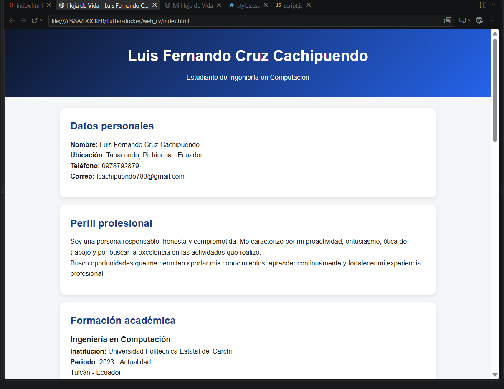
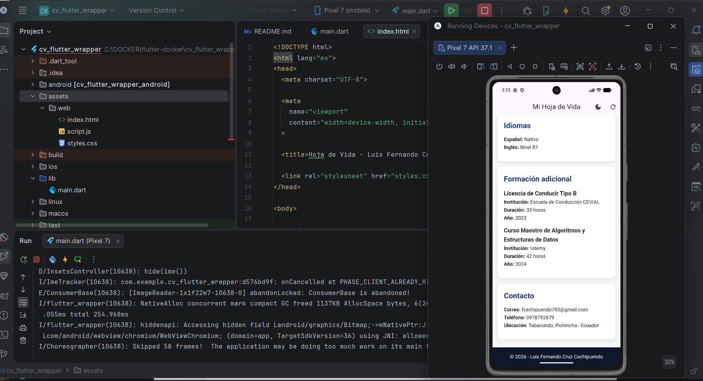
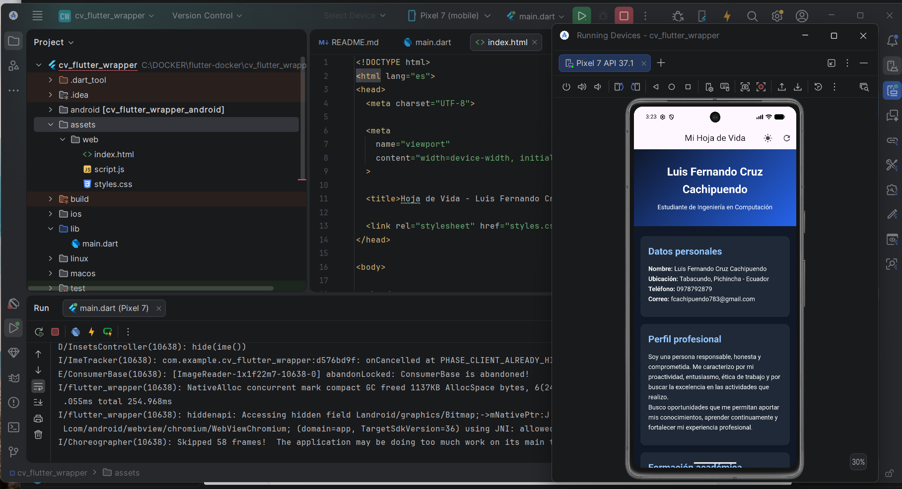

# Evolución de Hoja de Vida: De Nativo Android a Despliegue Web Embed en Flutter

## 1. Descripción

Este proyecto corresponde a la práctica de Desarrollo de Aplicaciones Móviles enfocada en la integración Web-Mobile mediante contenedores híbridos.

El objetivo principal fue transformar una hoja de vida a un formato web responsivo utilizando HTML5, CSS3 y JavaScript, para posteriormente integrarla dentro de una aplicación móvil desarrollada en Flutter mediante un WebView.

La práctica permitió combinar una interfaz web con controles nativos de Flutter, reutilizando el mismo contenido en diferentes plataformas.

---

## 2. Tecnologías utilizadas

- HTML5
- CSS3
- JavaScript
- Flutter
- Dart
- webview_flutter
- Android Studio
- Git

---

## 3. Fase 1: Desarrollo de la Hoja de Vida Web

Se desarrolló una hoja de vida responsiva utilizando tecnologías web.

La estructura fue realizada con HTML5 semántico, empleando elementos como:

- `header`
- `main`
- `section`
- `article`
- `footer`

El diseño fue desarrollado con CSS3 aplicando un enfoque Mobile-First para garantizar su correcta visualización en dispositivos móviles y pantallas de mayor tamaño.

También se implementaron funciones básicas mediante JavaScript.

La hoja de vida contiene las siguientes secciones:

- Datos personales
- Perfil profesional
- Formación académica
- Habilidades técnicas
- Aptitudes
- Idiomas
- Formación adicional
- Contacto

---

## 4. Fase 2: Integración en Flutter

Posteriormente se creó un proyecto Flutter llamado:

`cv_flutter_wrapper`

Dentro del proyecto se utilizó el paquete:

`webview_flutter`

La versión web de la hoja de vida fue almacenada localmente dentro de:

`assets/web/`

El contenido HTML se carga dentro de un WebView, permitiendo visualizar la hoja de vida desde una aplicación móvil Flutter.

Además, se incorporaron controles nativos desde Flutter:

- Botón para cambiar entre tema claro y oscuro.
- Botón para recargar la página.
- Indicador de carga durante la visualización del contenido.

---

## 5. Estructura del proyecto

```text
flutter-docker/
│
├── web_cv/
│   ├── index.html
│   ├── styles.css
│   └── script.js
│
├── cv_flutter_wrapper/
│   ├── android/
│   ├── assets/
│   │   └── web/
│   │       ├── index.html
│   │       ├── styles.css
│   │       └── script.js
│   ├── lib/
│   │   └── main.dart
│   └── pubspec.yaml
│
├── capturas_cv/
│   ├── 01_web_cv.png
│   ├── 02_flutter_claro.png
│   └── 03_flutter_oscuro.png
└── README.md
```
---

## 6. Evidencias

### Hoja de Vida en navegador



### Aplicación Flutter - Tema claro



### Aplicación Flutter - Tema oscuro



---

## 7. Comparación entre desarrollo nativo y enfoque embebido

| Aspecto | Desarrollo nativo Android | Web embebida en Flutter |
|---|---|---|
| Interfaz | Utiliza componentes propios de Android | Utiliza HTML, CSS y JavaScript dentro de WebView |
| Rendimiento | Integración más directa con el sistema | Incluye una capa adicional de renderizado web |
| Reutilización | Orientado principalmente a Android | El contenido web puede reutilizarse en distintas plataformas |
| Mantenimiento | Los cambios se realizan directamente en la aplicación | La interfaz puede modificarse desde HTML, CSS y JavaScript |
| Experiencia de usuario | Mayor integración con componentes nativos | Combina contenido web con controles Flutter |
| Funcionamiento offline | Puede trabajar localmente | Puede funcionar offline utilizando assets locales |
| Multiplataforma | Requiere adaptaciones según la plataforma | Facilita la reutilización del contenido web |
---

## 8. Análisis comparativo

El desarrollo nativo en Android ofrece una integración directa con los componentes y recursos del sistema operativo, lo que puede proporcionar una experiencia de usuario más cercana al entorno del dispositivo y un mayor control sobre el rendimiento.

Por otro lado, el enfoque híbrido implementado en esta práctica permite reutilizar una interfaz desarrollada con HTML5, CSS3 y JavaScript dentro de una aplicación Flutter mediante WebView. Esto facilita el mantenimiento de la interfaz y permite reutilizar el mismo contenido web en distintos entornos.

La solución embebida también permite combinar el contenido web con controles nativos de Flutter, como el botón para recargar la página y el cambio entre tema claro y oscuro.

En cuanto a mantenibilidad, el enfoque híbrido resulta conveniente porque gran parte de los cambios visuales pueden realizarse directamente sobre los archivos HTML, CSS y JavaScript, mientras que el desarrollo nativo requiere modificar directamente la interfaz de la aplicación.

En términos de rendimiento, el desarrollo nativo tiene una integración más directa con el sistema, mientras que el enfoque embebido utiliza una capa adicional de renderizado mediante WebView.

---

## 9. Conclusiones

1. La transformación de la hoja de vida a un formato web responsivo permitió adaptar correctamente el contenido a diferentes tamaños de pantalla mediante HTML5 y CSS3, cumpliendo con el enfoque Mobile-First planteado en la práctica.

2. La integración de la página web dentro de Flutter mediante WebView permitió reutilizar el contenido web dentro de una aplicación móvil y combinarlo con controles nativos como el cambio de tema claro/oscuro y la recarga de la página.

3. En comparación con una aplicación nativa, la solución embebida facilita la reutilización y el mantenimiento del código, ya que gran parte de los cambios visuales pueden realizarse directamente sobre HTML, CSS y JavaScript.

4. El desarrollo nativo ofrece una integración más directa con el sistema operativo, mientras que el enfoque híbrido utiliza una capa adicional de renderizado mediante WebView, lo que puede influir en el rendimiento, aunque aporta mayor flexibilidad para reutilizar la interfaz en distintas plataformas.

---

## 10. Bibliografía

- Flutter. (2025). *Flutter documentation*. Google. https://docs.flutter.dev
- Flutter Team. (2025). *webview_flutter* [Paquete de Dart]. https://pub.dev/packages/webview_flutter
- Marcotte, E. (2011). *Responsive Web Design*. A Book Apart.
- Mozilla. (2025). *MDN Web Docs: HTML, CSS y JavaScript*. https://developer.mozilla.org/es/
- Windmill, E. (2020). *Flutter in Action*. Manning Publications.
